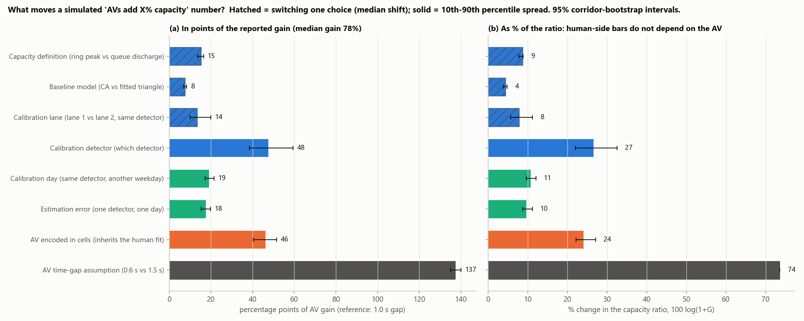
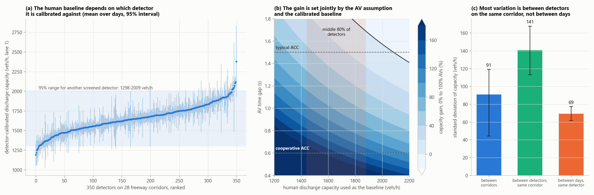
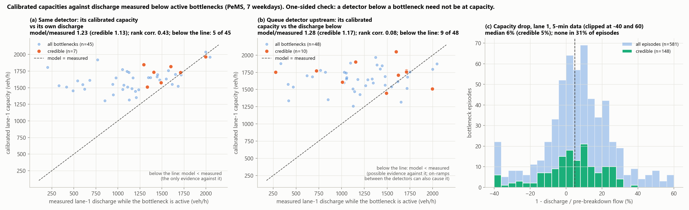

# What is hidden inside "AVs add X% capacity"?

Simulation studies of automated vehicles (AVs) often end with one number: freeway capacity rises by
some percentage when the cars are automated. That number is a ratio. On top is an assumption about
the AV. Underneath is a model of today's human drivers, usually calibrated against one detector, on
one day, with a modelling set-up few readers ever see.

I wanted to know how much those unseen choices move the answer. So I calibrated a traffic cellular
automaton against loop-detector data from **350 detectors on 28 freeway corridors** in the San
Francisco Bay Area (1,023 detector-days). Then I measured, side by side, how far each choice shifts
the reported AV gain.



**The AV assumption matters most**, as it should: a cooperative-ACC-like 0.6 s time gap versus a
typical 1.5 s ACC gap is a 137-point swing. Two choices that are rarely quantified each move the
answer by about a third as much:
* **which detector the human baseline was calibrated against:** about 48 percentage points between
  the 10th and 90th percentile of detectors;
* **writing the AV in the model's own cells and time steps:** a separate spread of about 46 points.

For scale, the calibration day spreads the gain by about 19 points and the estimation error by 18.
Switching the capacity definition shifts it by 15, calibrating lane 2 instead of lane 1 at the same
detector by 14, and switching from the CA to a simple fitted triangle by 8. The right-hand panel
shows the same quantities as percentage changes in the capacity ratio, which do not depend on the
AV assumed.

## What I found

**1. The human baseline depends far more on which detector you calibrate against than on the day.**
The calibrated queue-discharge capacity of lane 1 ranges from about 1,300 to 2,000 veh/h between
detectors (mean 1,654, a discharge headway of 2.18 s). Splitting that variation (95% intervals from
resampling corridors):
* 60% (43-79%) is between detectors on the same corridor;
* 25% (6-40%) is between corridors;
* 15% (11-22%) is between weekdays at the same detector, including estimation error.

The spread is not a quirk of the cellular automaton: a triangle fitted directly to the same data
shows it too (SD across detectors 202 veh/h, against 170 for the CA).

Why do detectors on the same corridor differ? Not mainly because of where they sit along it:
* Calibrating lane 2 at the same stations (637 detector-days) gives a similar spread between
  detectors. But the two lanes rank the detectors almost independently (rank correlation 0.13; 0.16
  within corridors).
* With the PeMS station metadata I tested position directly. Lane count, distance to the nearest on-
  and off-ramp, and sitting next to a recurring active bottleneck together add almost nothing within
  a corridor: adjusted R² +0.015, against a bar of 0.10 I set beforehand (+0.006 under my original,
  looser definition of "next to a bottleneck", under either detection rule). Ramp postmiles are only
  resolved to the interchange, so this tests position at that scale.
* A queue detector's *calibrated capacity* shows no detectable tracking of the discharge of the
  bottleneck below it (rank correlation 0.08, 95% interval −0.29 to 0.39, n=48).
* All the descriptors together explain only about a fifth of the spread.

So the differences are mostly specific to the lane and the loop: persistent measurement error in
individual detectors, or how traffic uses each lane. One lane-use signal does show up. At about 1 in
10 detectors, lane 1 runs more than 10 mph faster than lane 2 while the station is congested, as an
HOV lane would. These detectors calibrate about 95 veh/h below their corridor's average, but they
explain only about 2% of the spread.

Whatever the cause, the differences are stable from day to day, and a modeller inherits them by
calibrating at that detector, in that lane. Even the lane alone matters: lane 1 and lane 2 at the
same detector differ by about 8% (median absolute difference), with no systematic offset (median
ratio 0.98).



**2. An AV written in cells and steps silently inherits the human calibration.**
Cell-based models measure speed in cells per step. Define the AV as "same top speed, never
hesitates" and its real-world spacing depends on the step length fitted to the *human* data.
Several step lengths fit the humans equally well, so the AV's effective headway drifts between about
1.0 and 1.5 s from one equally good fit to the next. Defining the AV by a physical time gap removes
this. All AV numbers here use a no-hesitation, constant-time-gap follower (Newell's model), which
discharges from a queue at v / (v·g + 7.5 m). That gives the same definition of capacity, queue
discharge, on both sides of the ratio.

| AV time gap | Gain at the median detector | 10th-90th percentile across detectors |
|---|---|---|
| 0.6 s (cooperative ACC) | +162% | +131% to +202% |
| 1.0 s | +77% | +56% to +104% |
| 1.5 s (typical ACC) | +26% | +11% to +45% |

These gains are larger than published ones (Shladover et al. 2012: about +94% for full cooperative
ACC), mainly because the calibrated lane-1 baselines (mean 1,654 veh/h) are lower than typical
published per-lane queue discharge (about 2,000 pc/h per lane; Zhang & Levinson 2004). Against a 2,050 veh/h baseline, the same
0.6 s AV gives +112%, the same order as theirs.

**3. How capacity is measured still matters.** Read capacity off the flow-density peak of a small
simulated ring road, a common shortcut, and the answer depends on the ring's size. Slow-to-start
models are metastable, so this is a known finite-size effect (Barlovic et al. 1998). Measured
instead as the rate at which a standing queue empties, the same calibrated drivers have capacities
about 9% lower (median). That raises the reported gain by about 15 points.

## What the model is good for, and what it isn't

I tested the cellular automaton against simpler descriptions of the same data, scoring only
congested intervals (speed below 60 km/h) that were never used for fitting. Free-flow points are
almost an identity here, because density is computed as flow divided by speed.

* **It fits congestion as well as simpler alternatives, not better.** Calibrated on all intervals
  (80% free flow), the CA does worse on held-out congested hours (GEH 3.50) than a fitted triangle
  (3.29) or a model-free lookup of nearby observations (3.23). Weighting free flow and congestion
  equally in the calibration brings it level with both (3.24). Its capacities barely change (median
  ratio 1.00), and the detector spread remains (SD 184 vs 67 veh/h between days).
* **Its calibration is detector-specific in a way that lasts, but history predicts better.** A
  detector's calibrated parameters predict a new day better than one parameter set for all detectors
  (GEH 3.9 vs 4.9), and its capacity carries over to the new day (R² 0.46). But a simple lookup of the
  detector's own past data beats the calibrated CA on 83% of new detector-days.
* **Its capacity level matches a simpler estimate, though not one-for-one.** A fitted triangle gives
  the same level (median ratio 1.01). By a rule I fixed before comparing (rank correlation ≥ 0.9 and
  median difference < 3%), the two estimates still disagree: rank correlation 0.81, median difference
  4.4%. On noise-added triangular data with a known discharge, the calibration recovers it to within
  2.4% (median), but misses by more than 5% on 21% of days.
* **Against flow measured below real bottlenecks, its capacities come out higher, but this check is
  one-sided.** Using PeMS postmiles, I flagged active bottlenecks: a queue at one detector and free
  flow (at least 40 mph) at the next, at the same time (after Chen et al. 2004). While one is active,
  the lane-1 flow at the free-flowing detector is the discharge.
  * The flagged queues are dense (upstream occupancy about 22%). The median capacity drop is 6%, but
    a third of episodes show none, so on 5-minute lane-1 data this is only a rough check.
  * There are 45 bottlenecks whose free-flowing detector was also calibrated. There, the calibrated
    capacity is a median 23% above the lane-1 flow the detector carries (95% interval 13-54%,
    resampling corridors), and it ranks those flows only weakly (rank correlation 0.43).
  * At the 7 cleanest of them (recurring, well observed, no off-ramp in between), the gap is 13%
    (exact 95% interval -1% to +43%). That is too few to tell from zero.
  * But a free-flowing detector below a bottleneck need not be at capacity, and its lane 1 need not be
    saturated: over a quarter of these sites carry under 1,000 veh/h in lane 1. So "higher" is the
    expected sign, and the check bounds the error rather than measuring it. Only 5 of the 45 detectors
    show the opposite, by at most 9.5%.
  * A fitted triangle behaves the same way (28% higher; 3 of 44 the other way).
  * My first version of the detection rule did not check that the downstream detector was out of the
    queue. With it, the same comparison gave n=47, a 95% interval of 13-47% and rank correlation 0.42
    (queue detector: 0.13, n=51). The median gap, the 7 cleanest sites and the conclusions are unchanged.
* **Why a CA at all, then?** Because AV capacity studies often use this class of model, which is
  what makes point 2 matter. Here the CA is the object of study, not a better tool.



## What was already known, and what this adds

None of the individual effects is new:
* Capacity varies from site to site and day to day; stochastic capacity has been studied for decades
  (Brilon et al. 2005).
* Slow-to-start cellular automata have metastable, size-dependent flow peaks (Barlovic et al. 1998).
* A CA's time step is itself a fitted quantity (Knospe et al. 2004).
* AV and CACC capacity gains depend on the assumed time gap relative to human drivers (Shladover et
  al. 2012).

What this project adds is a measurement. One reproducible calibration pipeline, applied to 1,023
real detector-days, puts these choices side by side on one scale for an AV-capacity claim. It shows
that the choice of calibration detector and the way the AV is encoded each move the answer by about
a third as much as the AV assumption that studies usually discuss. It also checks the calibrated
capacities against discharge measured below real bottlenecks. That check is one-sided: it bounds the
error rather than measuring it.

## How it works

1. **Data.** Caltrans PeMS 5-minute counts, lane 1 of every mainline detector in District 4, five
   weekdays in Aug-Sep 2026, plus two later days kept aside for testing. A detector-day is kept only
   if it shows free flow, near-capacity flow and congestion. The PeMS station metadata gives each
   detector's postmile, lane count and the ramps around it.
2. **Model.** A two-class Nagel-Schreckenberg cellular automaton with slow-to-start, which gives it a
   capacity drop. A human driver is four numbers (top speed, dawdling while moving, hesitation when
   stopped, an extra following gap) plus a fitted step length.
3. **Simulate once, fit everywhere.** 1,980 candidate drivers are simulated once. Physical units enter
   only as scale factors, so the same library fits every detector.
4. **Fit and uncertainty.** Fitted with GEH on three of every four hours and tested on the fourth,
   then repeated on 500 block-resampled versions of each day (Künsch 1989).
5. **Capacity** is the rate at which a 2,000-vehicle standing queue discharges past a detector: the
   slope of the N-curve, as at real bottlenecks (Cassidy & Bertini 1999).

## Checks

* **The simulator reproduces exact results:** the triangular diagram with randomness off, and the
  closed-form solution at a top speed of one cell per step. Automated tests cover this
  (`python -m pytest -q`).
* **Simulation noise is small.** Re-simulating with new random numbers moves capacity by about 1%.
* **The density conversion matters little.** Computing density from occupancy with a fixed vehicle
  length (18-28 ft) instead of PeMS speeds shifts capacities by 1-2% at the median, with rank
  correlation 0.81-0.90.
* **The uncertainty is not fully settled.** The bootstrap error bars are wider than the real
  day-to-day spread at a detector (95 vs 69 veh/h). A synthetic recovery test points the other way:
  only 91% coverage for 95% intervals. I report both rather than pick one.
* **A pre-set agreement test came out negative.** Before comparing the CA's capacities with those of
  a fitted triangle, I fixed what would count as agreement: rank correlation ≥ 0.9 and median
  difference < 3%. They missed it (0.81 and 4.4%). So the capacity estimate is reported as dependent
  on the model at about the ±4% level. Separately, on congested held-out data the simpler model fits as
  well as the CA.

## What it can't tell you

* **The AV is an assumption.** This project measures how much the *human* side and the modelling
  set-up move the answer. It does not predict real AVs. The AV formula assumes the AV accelerates
  without limit, and it uses PeMS's partly assumed free-flow speed (about 119 km/h).
* **The capacities are not checked against a true bottleneck capacity.** Below active bottlenecks
  they sit above the measured lane-1 discharge (median 23%, n=45). That is the expected direction for
  a one-sided check, so it bounds the error rather than measuring it.
  * If part of that gap is real error, the human baseline is too high, and the absolute AV gains in
    point 2 are understated rather than overstated.
  * A common bias of this kind leaves the log-scale bars of the first figure (panel b) unchanged.
* **Lane 1 is the leftmost lane.** The District 4 metadata lists only 2 separate HOV stations, so HOV
  lanes are presumably counted inside mainline stations, where lane 1 is often the HOV lane itself.
  Its share of traffic is not its capacity.
* **The model is coarse.** 7.5 m cells mean accelerations of about 10 m/s² and whole-number speeds,
  and its discharge comes from standing queues, while real congestion is mostly moving queues
  (Yuan et al. 2015).
* **Speeds are partly estimated.** Most PeMS detectors are single loops; their speeds, including the
  free-flow level, are partly estimated by PeMS (Jia et al. 2001).
* **GEH is used outside its original setting.** It was designed for hourly volumes; here it scores
  5-minute flows.
* **Limited coverage:** one district, seven weekdays, a single lane, no lane changing.

**Next:**
* find out whether the calibrated capacities overshoot real bottleneck capacity, using oblique
  cumulative curves on 30-second data, lane by lane, with HOV lanes separated;
* recalibrate a continuous car-following model (IDM) through the same pipeline;
* give the AV a physical time gap natively.

## Run it

Python 3.10 or newer. The raw data is free with a PeMS account; `data/raw/README.md` lists the files.

```bash
pip install -r requirements.txt
python -m pytest -q
python scripts/run_all.py                 # everything, about 6.5 h on a 4-core laptop
python scripts/run_all.py --skip-checks   # skip the slow robustness checks, about 5 h
```

```
nasch/       simulator, capacity measurement, PeMS reader, calibration, baselines, bottlenecks
scripts/     numbered steps that produce every figure and table; run_all.py runs them in order
tests/       exact-result and regression checks
results/     output tables (CSV)       figures/   output figures
data/raw/    PeMS downloads (not in git)
```

## References

* Barlovic, R., Santen, L., Schadschneider, A. & Schreckenberg, M. (1998). Metastable states in cellular automata for traffic flow. *Eur. Phys. J. B* 5, 793-800.
* Brilon, W., Geistefeldt, J. & Regler, M. (2005). Reliability of freeway traffic flow: a stochastic concept of capacity. *Proc. 16th ISTTT*, 125-144.
* Cassidy, M. J. & Bertini, R. L. (1999). Some traffic features at freeway bottlenecks. *Transp. Res. B* 33, 25-42.
* Chen, C., Skabardonis, A. & Varaiya, P. (2004). Systematic identification of freeway bottlenecks. *Transp. Res. Rec.* 1867, 46-52.
* Jia, Z., Chen, C., Coifman, B. & Varaiya, P. (2001). The PeMS algorithms for accurate, real-time estimates of g-factors and speeds from single-loop detectors. *Proc. IEEE ITSC 2001*, 536-541.
* Knospe, W., Santen, L., Schadschneider, A. & Schreckenberg, M. (2004). Empirical test for cellular automaton models of traffic flow. *Phys. Rev. E* 70, 016115.
* Künsch, H. R. (1989). The jackknife and the bootstrap for general stationary observations. *Ann. Statist.* 17, 1217-1241.
* Li, Y., Yu, R., Shahabi, C. & Liu, Y. (2018). Diffusion convolutional recurrent neural network: data-driven traffic forecasting. *ICLR 2018* (PEMS-BAY sensor coordinates, used only if the PeMS station metadata is absent).
* Nagel, K. & Schreckenberg, M. (1992). A cellular automaton model for freeway traffic. *J. Phys. I* 2, 2221-2229.
* Schreckenberg, M., Schadschneider, A., Nagel, K. & Ito, N. (1995). Discrete stochastic models for traffic flow. *Phys. Rev. E* 51, 2939-2949.
* Shladover, S. E., Su, D. & Lu, X.-Y. (2012). Impacts of cooperative adaptive cruise control on freeway traffic flow. *Transp. Res. Rec.* 2324, 63-70.
* Yuan, K., Knoop, V. L. & Hoogendoorn, S. P. (2015). Capacity drop: relationship between speed in congestion and the queue discharge rate. *Transp. Res. Rec.* 2491, 72-80.
* Zhang, L. & Levinson, D. (2004). Some properties of flows at freeway bottlenecks. *Transp. Res. Rec.* 1883, 122-131.
* Data: Caltrans Performance Measurement System (PeMS), https://pems.dot.ca.gov
